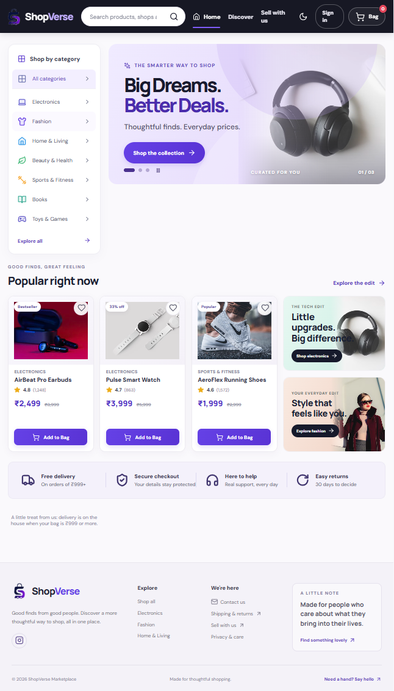
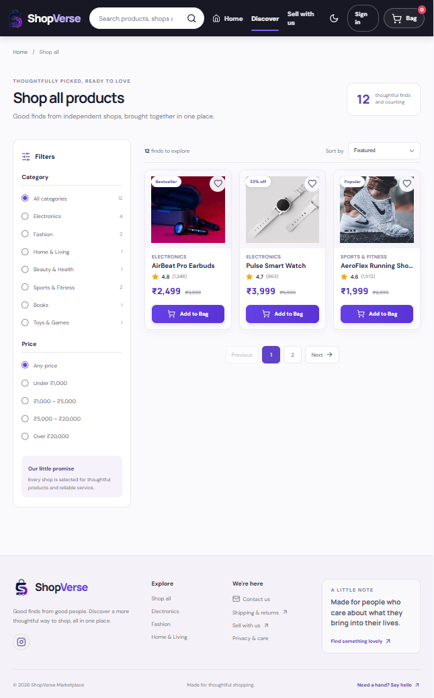
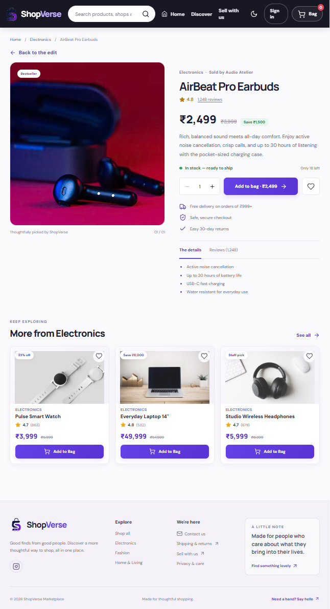
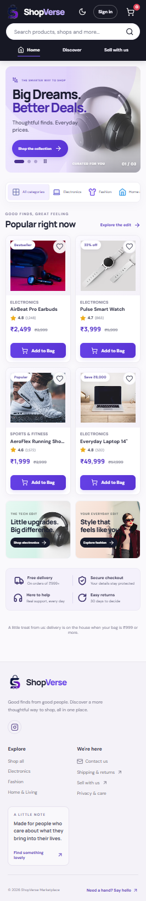

# ShopVerse Marketplace

ShopVerse is a polished, responsive marketplace storefront designed to make browsing independent shops and discovering everyday favorites feel effortless. It brings product discovery, a thoughtful shopping bag, and a streamlined demo checkout together in one modern shopping experience.

## Storefront preview

### Homepage

<p align="center">
  
</p>

### Product discovery

<p align="center">
  
</p>

### Product details

<p align="center">
  
</p>

### Responsive mobile experience

<p align="center">
  
</p>

## Features

- Browse a curated catalog with search, category and price filters, sorting, and pagination.
- Explore product details, customer ratings, availability, and related products.
- Save favorites and manage a persistent shopping bag.
- Use a responsive cart drawer, delivery estimates, and form-validated demo checkout.
- Switch between light and dark themes, with preferences remembered between visits.
- Navigate with accessible controls across desktop and mobile layouts.

## Built with

React, Vite, React Router, and Lucide icons.

## Run locally

```bash
npm install
npm run dev
```

Create and preview a production build:

```bash
npm run build
npm run preview
```

## Demo scope

This repository contains the storefront frontend and sample product data. Sign-in, seller tools, inventory, order storage, and checkout are demonstrations only; real authentication, payments, and order fulfillment require backend services.
